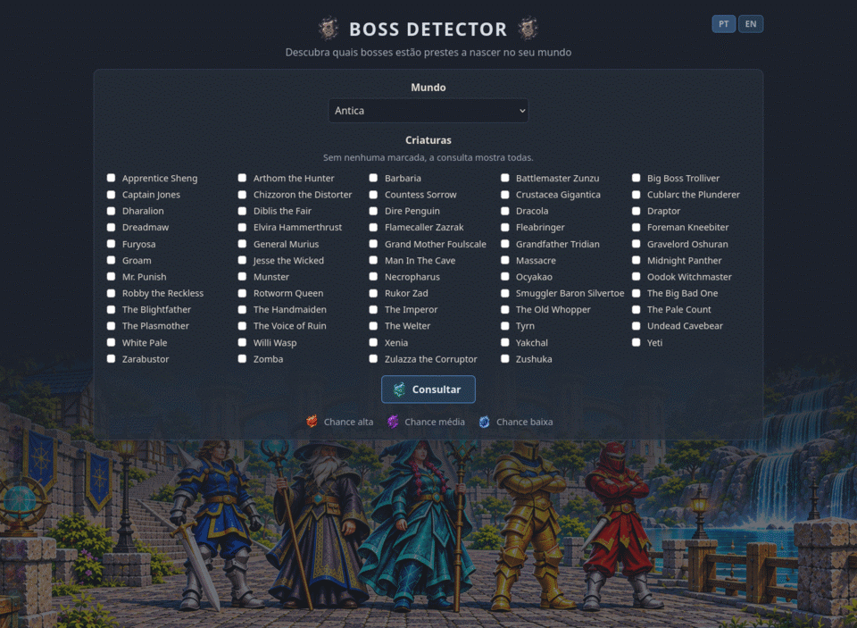
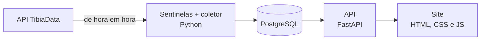

# Tibia Boss Detector

[](https://github.com/FernandoGali/tibia-boss-detector/actions/workflows/testes.yml)

Site que mostra a chance de cada boss e criatura rara do Tibia aparecer hoje, em cada mundo, a partir do histórico de mortes coletado todo dia.

**No ar:** https://bossdetector.duckdns.org



<sub>Os números do GIF são de exemplo, para mostrar as três faixas de chance. A coleta real começou em 07/11/2026.</sub>

## O problema e a solução

**Problema:** no Tibia, bosses e criaturas raras nascem em dias aleatórios em cada um dos 90 mundos, e o jogo não avisa quando.
**Dado disponível:** as kill statistics públicas de cada mundo mostram quantas vezes cada criatura morreu no dia anterior.
**Solução:** coletar essas estatísticas de todos os mundos todo dia, guardar o histórico no PostgreSQL e mostrar num site, por mundo, a chance de cada criatura aparecer (alta, média ou baixa) e quando ela é esperada.

## Arquitetura



Tudo roda numa VM grátis do Google Cloud: o coletor por um timer do systemd, a API e o site no mesmo processo, e o Caddy na frente cuidando do HTTPS.

## Em números

Retrato de 09/11/2026:

| | |
|---|---|
| Mundos acompanhados | 90 |
| Criaturas acompanhadas | 59 |
| Registros por dia | 5.310 (90 mundos × 59 criaturas) |
| Dias de histórico | 2 (desde 07/11/2026) |
| Registros no banco | 10.620 |
| Aparições registradas | 931 |
| Testes automatizados | 52, rodando no GitHub Actions com PostgreSQL |
| Hospedagem | Plano grátis do Google Cloud (e2-micro, 1 GB de RAM) |

## Decisões técnicas e aprendizados

**Por que sentinelas.** As kill statistics atualizam uma vez por dia, mas o horário não é divulgado. Consultar os 90 mundos de hora em hora daria mais de 2 mil requisições por dia. Em vez disso, 7 mundos "sentinela" (os mais cheios de cada região) são consultados de hora em hora; quando a soma das kills de um deles muda, é porque atualizou, e só então os 90 mundos são coletados. Depois da atualização do dia, as sentinelas param até o dia seguinte. Acompanhando assim, deu para descobrir o horário real: sempre entre 03:00 e 04:00 de Berlim.

**Por que o fuso de Berlim.** O Tibia roda no horário de Berlim, e a atualização do dia D traz as mortes do dia D-1. Usando o horário de Brasília, uma coleta feita logo depois da meia-noite de Berlim cairia no dia errado, e a diferença entre os dois fusos ainda muda com o horário de verão europeu (4 ou 5 horas). Por isso todas as datas do projeto são de Berlim, e a data salva é a do dia das mortes, não a do dia da coleta.

**Por que juntar os mundos na previsão.** A regra de nascimento de uma criatura é a mesma em todos os mundos. Calculando o intervalo entre aparições só dentro de um mundo, uma criatura rara levaria meses para ter dados suficientes. Juntando os intervalos dos 90 mundos, o histórico cresce 90 vezes mais rápido. O intervalo típico é a mediana, e não a média, porque um boss que nasce e ninguém mata deixa um intervalo longo demais que puxaria a média para cima.

**O que deu errado no caminho:**

- **O zero que não era zero.** Durante quase duas semanas, 8 criaturas apareceram com 0 mortes em todos os mundos. Parecia que eram só raras. Comparando com os nomes que a API realmente usa, a causa era outra: criaturas comuns vêm no plural e em minúsculas ("dire penguins", "yetis") e alguns bosses com maiúsculas diferentes ("Arthom The Hunter"). O coletor procurava o nome exato e nunca achava. A correção foi comparar sem diferenciar maiúsculas e manter uma tabela com os nomes no plural. Como o histórico daqueles dias estava errado, a contagem foi zerada e recomeçou do zero.
- **"Dados até hoje" que não eram de hoje.** A primeira versão do site mostrava a data da consulta como se fosse a data dos dados. Como a atualização traz o dia anterior, o site prometia um dia que ainda não existia no banco. A linha foi tirada, já que cada card já mostra suas próprias datas.
- **Previsão com dado de menos.** A primeira previsão usava a média dos intervalos de um mundo só e aparecia a partir de 2 aparições. Com tão pouco dado, ela mudava muito de um dia para o outro. Daí veio a mudança para a mediana dos 90 mundos, com um mínimo de 4 intervalos antes de mostrar qualquer chance.
- **Hospedagem grátis com 1 GB de memória.** A VM grátis tem só 1 GB de RAM para o PostgreSQL, a API e a coleta. O PostgreSQL foi ajustado para usar pouca memória, a máquina ganhou 2 GB de swap como folga, e a API reaproveita conexões com o banco em vez de abrir uma por consulta.

## Como funciona

Um script roda de hora em hora e faz duas coisas:

1. Consulta alguns mundos "sentinela" para saber se as kill statistics já foram atualizadas
2. Se atualizaram, coleta as criaturas raras de todos os mundos e salva no banco

As kill statistics atualizam uma vez por dia, de madrugada no horário de Berlim (acompanhei vários dias e foi sempre entre 03:00 e 04:00, todas as regiões juntas). A atualização do dia D traz as mortes do dia D-1, então é essa a data que fica salva. Todas as datas do projeto usam o horário de Berlim, que é o horário do Tibia.

Sentinelas são os mundos mais cheios de cada região: 2 da Europa, 2 da América do Norte, 2 da América do Sul e 1 da Oceania (que só tem 3 mundos). Se a soma das kills de uma sentinela mudou de uma hora para outra, é porque atualizou.

Se algum mundo falhar ou ainda estiver com os números do dia anterior, ele é coletado de novo na hora seguinte.

### Arquivos

- `main.py` - roda tudo (sentinela e depois coletor)
- `sentinela.py` - descobre quando as kill statistics atualizaram
- `coletor.py` - coleta dos mundos
- `criaturas.py` - lista das criaturas raras
- `tibia.py` - consultas à API do TibiaData
- `tempo.py` - fusos e horários do Tibia
- `registro.py` - log
- `banco.py` - tudo que mexe no PostgreSQL
- `api.py` - API que o site usa (e que também entrega o site)
- `site/` - o site: página de seleção (`index.html`), página de resultado (`resultado.html`), estilo, script e imagens

### Previsão

Para cada criatura, o projeto mede os **intervalos**: quantos dias se passaram entre duas aparições seguidas no mesmo mundo. Como a regra de nascimento de uma criatura é a mesma em todos os mundos, os intervalos de todos os mundos são juntados, e o **intervalo típico** é a mediana deles.

Em cada mundo, a chance compara esse intervalo com os dias desde a última aparição naquele mundo: passou do intervalo, a chance é **alta**; passou da metade, **média**; antes disso, **baixa**. A previsão só aparece a partir de 4 intervalos. Abaixo disso, o site mostra quantos faltam.

## Limitações

A previsão é uma estimativa a partir de dados públicos, não uma regra do jogo. Vale saber de onde ela pode errar:

- **O que se mede é a morte, não o nascimento.** As kill statistics só registram criaturas mortas. Um boss que nasce e ninguém mata não aparece, e o intervalo registrado fica maior do que o real. Um boss morto dias depois de nascer conta no dia da morte. A mediana diminui o efeito desses casos, mas não elimina.
- **A regra de nascimento não é oficial.** A CipSoft não divulga como os bosses nascem. Juntar os mundos parte da ideia de que a regra é a mesma em todos, o que é a suposição mais aceita pela comunidade, mas não é garantida.
- **Só existe o dia, não a hora.** As kill statistics são diárias e chegam com um dia de atraso (a atualização do dia D traz o dia D-1). Não dá para saber em que horário a criatura apareceu, e o dia de hoje só entra amanhã.
- **Dia perdido não volta.** A API só mostra o último dia. Se a coleta falhar o dia inteiro (API fora do ar, servidor desligado), aquele dia fica sem dados, e um intervalo pode parecer maior do que foi.
- **Eventos e quests distorcem.** Se uma criatura aparece por evento, quest ou invocação, as mortes entram na mesma conta que os nascimentos normais.
- **Pouco histórico no começo.** Com poucos dias coletados, a maioria das criaturas fica sem previsão até juntar 4 intervalos. Criaturas muito raras podem levar meses.
- **Depende do TibiaData.** Os dados vêm de uma API mantida pela comunidade, que pode mudar ou sair do ar.

## Instalação

Precisa de Python 3.13+ e PostgreSQL.

```bash
git clone https://github.com/FernandoGali/tibia-boss-detector.git
cd tibia-boss-detector
python -m venv .venv
source .venv/bin/activate      # Linux
# .venv\Scripts\activate       # Windows
pip install -r requirements.txt
```

### Banco de dados

Criar o usuário e o banco (como administrador no psql, pgAdmin ou DBeaver):

```sql
CREATE USER boss_detector WITH PASSWORD 'sua_senha';
CREATE DATABASE boss_detector OWNER boss_detector;
```

Usa uma senha só com letras e números, porque ela vai dentro de uma URL e símbolos como `@` e `:` quebram a conexão.

Depois copia o modelo `.env.example` para `.env` e troca `sua_senha` pela senha que você criou:

```bash
cp .env.example .env
```

O `.env` fica fora do git. O `.env.example` mostra quais variáveis o projeto precisa, sem nenhuma senha.

E cria as tabelas:

```bash
python banco.py
```

Tabelas:

- `snapshots` - uma linha por mundo, criatura e dia
- `coletas` - quais mundos já foram coletados em cada dia
- `sentinelas` - os mundos usados como sentinela
- `leituras_sentinela` - as leituras de hora em hora

## Como rodar

```bash
python main.py
```

O que acontece em cada execução fica salvo no `boss_detector.log`.

### De hora em hora no Linux

Uso um timer do systemd no usuário. Cria os dois arquivos em `~/.config/systemd/user/`:

`boss-detector.service`

```ini
[Unit]
Description=Boss Detector - coleta
After=network-online.target

[Service]
Type=oneshot
WorkingDirectory=/caminho/do/projeto
ExecStart=/caminho/do/projeto/.venv/bin/python main.py
```

`boss-detector.timer`

```ini
[Unit]
Description=Boss Detector - de hora em hora no minuto 05

[Timer]
OnCalendar=*-*-* *:05:00
Persistent=true

[Install]
WantedBy=timers.target
```

E liga o timer:

```bash
systemctl --user daemon-reload
systemctl --user enable --now boss-detector.timer
```

O `Persistent=true` faz ele rodar assim que o computador ligar se perdeu algum horário. Para conferir: `systemctl --user list-timers`.

### De hora em hora no Windows

Para rodar de hora em hora no Windows, eu uso o Agendador de Tarefas com o `pythonw.exe` (que roda sem abrir janela). No PowerShell:

```powershell
$projeto = "C:\caminho\do\projeto"
$pythonw = "C:\caminho\do\Python\pythonw.exe"

$acao    = New-ScheduledTaskAction -Execute $pythonw -Argument "main.py" -WorkingDirectory $projeto
$gatilho = New-ScheduledTaskTrigger -Once -At "00:05" -RepetitionInterval (New-TimeSpan -Hours 1)
$opcoes  = New-ScheduledTaskSettingsSet -StartWhenAvailable -AllowStartIfOnBatteries -DontStopIfGoingOnBatteries

Register-ScheduledTask -TaskName "Tibia Sentinela" -Action $acao -Trigger $gatilho -Settings $opcoes
```

### Site e API

```bash
fastapi dev api.py
```

O site abre em `http://127.0.0.1:8000`. A API roda junto, no mesmo endereço, e a documentação com todos os endereços dela fica em `http://127.0.0.1:8000/docs`.

- `/mundos` - lista de mundos
- `/criaturas` - lista de criaturas raras
- `/consulta?mundo=Kalibra&criaturas=Yakchal` - semáforo de cada criatura no mundo (sem `criaturas`, devolve todas)

## Testes

```bash
python -m pytest
```

Os testes não usam a API de verdade. Os que mexem no banco usam um banco separado, o `boss_detector_teste`, que é apagado a cada teste. Para criar (conectado como `postgres`):

```sql
CREATE DATABASE boss_detector_teste OWNER boss_detector;
```

Ele usa o mesmo usuário e senha do `.env`, então não precisa configurar mais nada. Sem esse banco, esses testes são pulados.

## Servidor

O site roda numa VM grátis do Google Cloud (e2-micro, Ubuntu 26.04), com tudo na mesma máquina:

- **PostgreSQL** - acessível só de dentro do servidor
- **Site e API** - `uvicorn` ouvindo só em `127.0.0.1:8000`
- **Caddy** - recebe as visitas e cuida do HTTPS (certificado do Let's Encrypt, renovado sozinho)
- **Domínio** - subdomínio grátis do [DuckDNS](https://www.duckdns.org) apontando para o IP da VM

O projeto fica em `~/boss-detector` e roda com estes serviços do systemd:

| Serviço | O que faz |
|---|---|
| `boss-detector-site.service` | Site e API, sempre ligado (reinicia sozinho se cair) |
| `boss-detector.timer` | Coleta de hora em hora, no minuto 05 |
| `boss-detector-backup.timer` | Backup do banco todo dia às 05:30, guardando os últimos 7 dias em `~/backups` |

### Atualizar o servidor

Depois de mandar as mudanças para o GitHub:

```bash
ssh usuario@servidor
cd ~/boss-detector
git pull
.venv/bin/pip install -r requirements.txt   # só se o requirements.txt mudou
sudo systemctl restart boss-detector-site
```

A coleta não precisa reiniciar: o timer roda o `main.py` atualizado na próxima hora.

### Ver o que está acontecendo

```bash
systemctl status boss-detector-site                 # site e API
systemctl list-timers "boss-detector*"              # próximas coletas e backups
tail -f ~/boss-detector/boss_detector.log           # log da coleta
journalctl -u boss-detector-site -f                 # log do site
```
